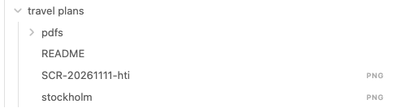
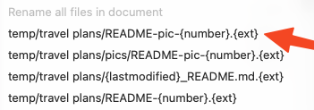
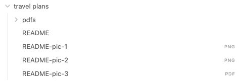

# Attachment Tools (Obsidian plugin)

This tool helps you organise your attachment names and their locations.

## Example 1



Referenced the files in the README:

```markdown


```

Make a rename choice (this is configurable):



Result




# Developer notes

- Place this repo inside the `.obsidian/plugins/pluginname` folder
- Inside Obsidian
  - Install the hot reload plugin <https://github.com/shabegom/obsidian-hot-reload-mobile> to get automatic reload when saving a `.ts` file
  - Enable both plugins in settings
- Run `npm run dev`
- See the top right notification inside Obsidian that the change was detected

Also, show the developer console inside obsidian to view `console.log` output :)

Ps. Obsidian loads the compiled `main.js` from this folder.
